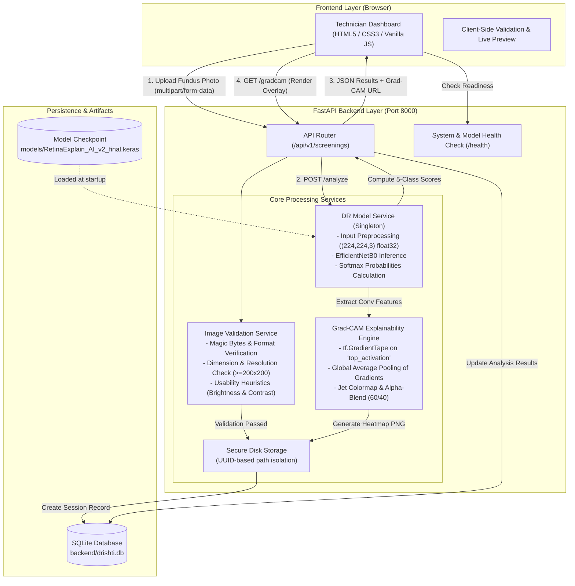

# DRISHTI-AI

**Explainable AI-Assisted Diabetic Retinopathy Screening Support for Rural India**  
**Team:** SPARK | **Category:** Open Innovation | **Prototype Stage:** 36-Hour Hackathon Research Prototype

> ⚠️ **IMPORTANT CLINICAL & REGULATORY DISCLAIMER**  
> DRISHTI-AI is an experimental computer-vision screening-support prototype designed for preliminary triage research and technical demonstration. It is **NOT** a certified medical device, does **NOT** provide a definitive medical diagnosis, and **MUST NEVER** replace clinical evaluation by a certified ophthalmologist or qualified eye care specialist.

---

## Table of Contents
1. [Project Identity](#1-project-identity)
2. [Problem Statement](#2-problem-statement)
3. [Our Solution](#3-our-solution)
4. [Key Features](#4-key-features)
5. [Technology Stack](#5-technology-stack)
6. [System Architecture](#6-system-architecture)
7. [Repository Structure](#7-repository-structure)
8. [Prerequisites and Installation](#8-prerequisites-and-installation)
9. [API Documentation](#9-api-documentation)
10. [Model Information](#10-model-information)
11. [Testing & Verification](#11-testing--verification)
12. [Visual Assets and Demo](#12-visual-assets-and-demo)
13. [Team SPARK](#13-team-spark)
14. [Limitations and Responsible Use](#14-limitations-and-responsible-use)
15. [Future Work](#15-future-work)
16. [License and Credits](#16-license-and-credits)

---

## 1. Project Identity

- **Project Name:** DRISHTI-AI (दृष्टि — *Vision / Insight*)
- **Team Name:** SPARK
- **Tagline:** Explainable AI-Assisted Diabetic Retinopathy Screening Support for Rural India
- **Repository:** [https://github.com/ysirishchandra-lgtm/drishti-ai](https://github.com/ysirishchandra-lgtm/drishti-ai)

### Introduction
Diabetic Retinopathy (DR) is a secondary microvascular complication of diabetes that damages retinal blood vessels and is a leading cause of preventable adult blindness. In low-resource and rural settings, specialized ophthalmologists and fundus reading facilities are concentrated in urban tertiary hospitals, leaving primary vision centers and community health workers with limited diagnostic support.

**DRISHTI-AI** is a full-stack screening prototype that bridges this gap. It provides frontline health workers with an easy-to-use interface to upload digital retinal fundus photographs, perform immediate pre-screening image validation checks, run a 5-class deep learning classification model, visualize activation heatmaps via Grad-CAM for transparent explainability, and maintain an audit log of patient screenings.

---

## 2. Problem Statement

Diabetic Retinopathy progresses asymptomatically through early stages before causing severe, irreversible vision impairment. Timely detection through regular retinal examinations enables preventative laser photocoagulation, anti-VEGF therapy, or glycemic control adjustments that can prevent blindness.

However, widespread routine screening in underserved regions faces critical bottlenecks:
1. **Severe Specialist Shortage:** Community vision centers often lack on-site retina specialists to interpret fundus photographs.
2. **Quality & Usability Issues:** A significant proportion of photographs captured by portable or handheld cameras suffer from underexposure, blur, or poor contrast, requiring patient recalls.
3. **Black-Box AI Skepticism:** Clinicians and healthcare workers hesitate to trust automated predictions without visual explanation of the retinal regions driving the classification.
4. **Disorganized Screening Records:** Rural clinics often rely on fragmented physical logbooks, hindering continuity of care and secondary referral tracking.

---

## 3. Our Solution

DRISHTI-AI addresses these challenges through a cohesive, self-contained screening pipeline:

1. **Client-Side & Server-Side Image Ingestion:** Accepts digital fundus photographs in standard formats (JPEG, PNG, WebP) with strict format validation and file size caps (15 MB).
2. **Preliminary Technical Usability Heuristics:** Evaluates essential image parameters (dimensions, brightness, contrast) to alert operators before running inference.
3. **5-Class Deep Learning Inference:** Integrates a fine-tuned EfficientNetB0 convolutional neural network to classify the fundus image into one of five standard international severity stages.
4. **Visual Explainability via Grad-CAM:** Generates activation heatmaps using Gradient-weighted Class Activation Mapping (Grad-CAM) overlaid directly onto the retinal image, highlighting the pathological regions (such as microaneurysms, hemorrhages, or exudates) influencing the model's prediction.
5. **Persistent Audit History:** Saves every screening session—including validation flags, prediction class, confidence score, class probability distribution, and Grad-CAM overlay—into an ACID-compliant SQLite database.
6. **Unified Lightweight Architecture:** Can be run locally as a unified FastAPI web service or with a decoupled static frontend.

---

## 4. Key Features

Every feature listed below is verified in the active codebase:

| Feature | Implementation Details | Verified Status |
|---|---|:---:|
| **Fundus Image Upload & Ingestion** | Drag-and-drop or file browser upload. Validates magic bytes, decodes via Pillow, enforces 15 MB limit and minimum 200×200 resolution. | **Operational** |
| **Technical Usability Heuristics** | Computes grayscale mean brightness and standard deviation contrast. Flags underexposed, overexposed, or flat-contrast photographs. | **Operational** |
| **5-Class DR Classification** | Infers severity stages: *No DR (0)*, *Mild (1)*, *Moderate (2)*, *Severe (3)*, *Proliferative DR (4)*. | **Operational** |
| **Probability Distribution** | Returns granular softmax probabilities for all five stages alongside the top prediction confidence. | **Operational** |
| **Grad-CAM Explainability** | Computes gradients on the EfficientNetB0 `top_activation` layer, generates a 2D activation map, applies Jet colormap, and alpha-blends (60% fundus / 40% heatmap) as a PNG overlay. | **Operational** |
| **Screening Record Persistence** | SQLite database (`screenings` table) stores timestamps, file paths, quality heuristics, prediction results, and Grad-CAM paths. | **Operational** |
| **Screening History Exploration** | Paginated REST endpoint (`GET /api/v1/screenings`) and frontend table to view previous screenings. | **Operational** |
| **System & Model Health Checks** | Dedicated `/health` endpoint returning server uptime, versioning, model readiness (`ready`), and loaded model artifact name. | **Operational** |
| **Responsive Web Interface** | Clean, accessible dashboard built with HTML5/CSS3/Vanilla JS featuring real-time connectivity badges, image previews, and results side-by-side. | **Operational** |

*Note on Prototype Scope:* DRISHTI-AI does not include multi-tenant user authentication, cloud PACS DICOM ingestion, or hardware camera integration.

---

## 5. Technology Stack

DRISHTI-AI uses a focused, lightweight technology stack without extraneous frameworks:

### Frontend
- **HTML5:** Semantic document structure, accessibility elements, and native file inputs.
- **CSS3:** Custom responsive layout, CSS variables/tokens, flexbox/grid, and transition animations (Vanilla CSS; no heavy component libraries).
- **JavaScript (ES6+):** Vanilla asynchronous client logic, drag-and-drop handlers, dynamic DOM rendering, and API communication.

### Backend & API
- **Python 3.10+ (Tested on Python 3.13):** Core backend runtime.
- **FastAPI (0.115+):** High-performance async REST framework with automatic OpenAPI/Swagger documentation.
- **Uvicorn (0.30+):** ASGI server powering local serving.
- **Pillow (PIL 10.4+):** Memory-safe image decoding, validation, and dimension inspection.
- **Pydantic (v2.8+):** Strict schema definition and request/response validation.

### Database
- **SQLite3:** Embedded relational database (Python standard library `sqlite3`), zero external daemon dependencies.

### Machine Learning & Explainability
- **TensorFlow (2.16+) & Keras (3.0+):** Deep learning framework for model loading and tensor operations.
- **EfficientNetB0:** Pre-trained convolutional neural network backbone with custom GlobalAveragePooling2D, Dropout(0.3), and Dense(5, softmax) head.
- **Grad-CAM (`tf.GradientTape`):** Class activation mapping computed with respect to the `top_activation` convolutional feature layer.
- **NumPy (1.26+ / 2.0+):** High-performance array operations and colormap vectorization.

### Testing & Quality Assurance
- **Pytest (8.3+):** Test runner with fixture-based unit and integration test coverage.
- **HTTPX (0.27+):** Synchronous and async HTTP client for FastAPI `TestClient` API testing.

---

## 6. System Architecture



---

## 7. Repository Structure

```
drishti-ai/
├── README.md                                # Comprehensive hackathon presentation guide (this file)
├── PROJECT_BOOK.md                          # Live engineering log, milestone logs, and test audits
├── .gitignore                               # Git exclusion rules for environments, caches, DBs, and uploads
├── backend/                                 # FastAPI application and test suite
│   ├── requirements.txt                     # Backend dependencies (FastAPI, TensorFlow, Keras, etc.)
│   ├── app/
│   │   ├── __init__.py                      # Package initialization & semantic versioning
│   │   ├── main.py                          # FastAPI app entry point, lifespan, CORS, and static mount
│   │   ├── database.py                      # SQLite database schema, connections, and query operations
│   │   ├── api/
│   │   │   ├── __init__.py                  # API router aggregator
│   │   │   └── v1/
│   │   │       ├── __init__.py
│   │   │       └── screenings.py            # Endpoints: upload, analyze, gradcam, record, history
│   │   ├── schemas/
│   │   │   ├── __init__.py
│   │   │   └── screening.py                 # Pydantic models for request/response serialization
│   │   └── services/
│   │       ├── __init__.py
│   │       ├── image_service.py             # Image validation, heuristics, and disk storage
│   │       └── model_service.py             # Keras model loading, inference, and Grad-CAM generation
│   └── tests/                               # Comprehensive automated test suite
│       ├── __init__.py
│       ├── test_api.py                      # 15 API routing, upload, validation, and error handling tests
│       ├── test_frontend_integration.py     # 6 frontend static delivery, CORS, and contract tests
│       └── test_model_service.py            # 5 model loading, inference, Grad-CAM, and edge case tests
├── frontend/                                # Clean, responsive web frontend
│   ├── index.html                           # Single-page technician screening interface
│   ├── styles.css                           # Modern stylesheet, design tokens, responsive cards
│   ├── app.js                               # API integration, drag-and-drop, UI state handling
│   ├── README.md                            # Frontend integration overview
│   ├── PROJECT_BOOK.md                      # Frontend development log
│   ├── eye-hero-poster.jpg                  # Visual preview image for hero banner
│   ├── drishti-hero-cinematic.jpg           # High-resolution clinical illustration
│   └── assets/                              # Static media assets
│       ├── drishti-hero-cinematic.jpg       # Static hero image
│       └── drishti-intro.mp4                # Hackathon video walkthrough trailer
├── models/                                  # Trained machine learning model artifacts
│   ├── .gitkeep
│   ├── DRISHTI_1.ipynb                      # Complete training, evaluation, and export Jupyter notebook
│   └── RetinaExplain_AI_v2_final.keras      # Saved Keras model artifact (EfficientNetB0, 16.3 MB)
└── docs/                                    # Technical specifications and clinical data audits
    ├── api-contract.md                      # Detailed API specification with JSON request/response schemas
    ├── architecture.md                      # Structural architecture and component boundaries
    ├── dataset_audit_report.md              # 2,500 balanced image audit across APTOS, DDR, and IDRiD
    ├── dataset_audit_aptos2019.md           # APTOS 2019 dataset breakdown and license audit
    ├── dataset_audit_ddr.md                 # OIA-DDR dataset quality analysis
    └── split_integrity_report.md            # Train/validation/test split isolation and deduplication report
```

---

## 8. Prerequisites and Installation

### Prerequisites
- **Operating System:** Windows 10/11, macOS, or Linux
- **Python:** Version 3.10 through 3.13 (Verified on Python 3.13)
- **Git:** Version 2.30+
- **Browser:** Any modern web browser (Google Chrome, Mozilla Firefox, Microsoft Edge, Safari)

---

### Step-by-Step Setup (Windows PowerShell)

Open PowerShell and run the following commands:

#### 1. Clone the Repository
```powershell
git clone https://github.com/ysirishchandra-lgtm/drishti-ai.git
cd drishti-ai
```

#### 2. Create and Activate a Virtual Environment
```powershell
python -m venv backend\.venv
.\backend\.venv\Scripts\Activate.ps1
```
*(If script execution is disabled on PowerShell, run `Set-ExecutionPolicy -Scope Process -ExecutionPolicy Bypass` before activating).*

#### 3. Install Python Dependencies
```powershell
pip install -r backend\requirements.txt
```

#### 4. Verify Model Artifact
The trained model artifact is tracked directly in the repository at `models/RetinaExplain_AI_v2_final.keras` (16.3 MB). Verify that it is present:
```powershell
Test-Path models\RetinaExplain_AI_v2_final.keras
```
*(Should return `True`).*

---

### Running the Application

You can launch DRISHTI-AI in one of two ways:

#### Option A: Unified Application Mode (Recommended)
FastAPI serves the REST API endpoints and automatically hosts the static frontend on port 8000:
```powershell
python -m uvicorn app.main:app --host 127.0.0.1 --port 8000 --app-dir backend
```
- **Web Application:** [http://127.0.0.1:8000/](http://127.0.0.1:8000/)
- **Interactive Swagger API Docs:** [http://127.0.0.1:8000/docs](http://127.0.0.1:8000/docs)
- **ReDoc Documentation:** [http://127.0.0.1:8000/redoc](http://127.0.0.1:8000/redoc)
- **Health Check:** [http://127.0.0.1:8000/health](http://127.0.0.1:8000/health)

#### Option B: Decoupled Development Mode
Run the backend on port 8000 and run a separate static server for the frontend on port 8080:

```powershell
# Terminal 1 — Backend:
cd drishti-ai
.\backend\.venv\Scripts\Activate.ps1
python -m uvicorn app.main:app --host 127.0.0.1 --port 8000 --app-dir backend

# Terminal 2 — Frontend:
cd drishti-ai
python -m http.server 8080 --directory frontend
```
Open [http://127.0.0.1:8080](http://127.0.0.1:8080) in your browser. The frontend automatically detects the local backend on port 8000 via CORS.

---

## 9. API Documentation

All endpoints are versioned under `/api/v1/` except the global `/health` and OpenAPI `/docs`.

### Summary of Implemented Endpoints

| Method | Endpoint | Description | Request Format | Response Status |
|---|---|---|---|:---:|
| `GET` | `/health` | System health, version, model readiness (`ready`), and supported classes | None | `200 OK` |
| `POST` | `/api/v1/screenings/upload` | Multipart upload, decodes image, computes usability heuristics, saves file | `multipart/form-data` (`file`) | `201 Created` |
| `POST` | `/api/v1/screenings/{id}/analyze` | Runs inference, computes Grad-CAM, updates database record | None | `200 OK` |
| `GET` | `/api/v1/screenings/{id}/gradcam` | Serves the generated Grad-CAM heatmap PNG overlay | None | `200 OK` (`image/png`) |
| `GET` | `/api/v1/screenings/{id}` | Retrieves full screening record, predictions, and quality flags | None | `200 OK` |
| `GET` | `/api/v1/screenings` | Lists historical screening records with pagination | Query: `?page=1&page_size=20` | `200 OK` |

---

### Detailed Endpoint Specifications

#### 1. System Health Check
`GET /health`

**Sample Response (`200 OK`):**
```json
{
  "status": "ok",
  "project": "DRISHTI-AI",
  "version": "0.1.0",
  "model_status": "ready",
  "model_name": "RetinaExplain_AI_v2_final",
  "supported_classes": [
    "No DR",
    "Mild",
    "Moderate",
    "Severe",
    "Proliferative DR"
  ],
  "timestamp": "2026-10-11T01:34:00.000000Z"
}
```

#### 2. Upload and Validate Fundus Image
`POST /api/v1/screenings/upload`  
*Header:* `Content-Type: multipart/form-data`  
*Body:* `file` (Binary image file: JPEG, PNG, or WebP)

**Sample Response (`201 Created`):**
```json
{
  "screening_id": "bf54b9cc-714a-4c34-bc02-1c130b9b532e",
  "file_name": "fundus_scan.jpg",
  "validation_passed": true,
  "mime_type": "image/jpeg",
  "dimensions": {
    "width": 1050,
    "height": 1050
  },
  "file_size_bytes": 975218,
  "image_quality": {
    "mean_brightness": 85.5,
    "contrast_std": 46.5,
    "is_blurry": false,
    "heuristic_status": "acceptable",
    "rejection_reasons": []
  },
  "model_status": "ready",
  "human_review_status": "pending",
  "follow_up_status": "none",
  "created_at": "2026-10-11T01:34:02.123456Z"
}
```

#### 3. Analyze Screening Record
`POST /api/v1/screenings/{screening_id}/analyze`

**Sample Response (`200 OK`):**
```json
{
  "screening_id": "bf54b9cc-714a-4c34-bc02-1c130b9b532e",
  "model_status": "ready",
  "analysis_available": true,
  "prediction": "No DR",
  "confidence": 0.7489,
  "class_probabilities": {
    "No DR": 0.7489,
    "Mild": 0.1784,
    "Moderate": 0.0555,
    "Severe": 0.0125,
    "Proliferative DR": 0.0047
  },
  "gradcam_available": true,
  "gradcam_url": "/api/v1/screenings/bf54b9cc-714a-4c34-bc02-1c130b9b532e/gradcam",
  "analyzed_at": "2026-10-11T01:34:05.987654Z"
}
```

#### 4. Grad-CAM Activation Heatmap Overlay
`GET /api/v1/screenings/{screening_id}/gradcam`

Returns binary `image/png` content representing the fundus photograph blended (60% original / 40% heatmap) with Jet colormap activation highlights.

---

## 10. Model Information

The deep-learning classification pipeline was developed and trained in the notebook [`models/DRISHTI_1.ipynb`](models/DRISHTI_1.ipynb).

### Architecture Details
- **Base Architecture:** EfficientNetB0 (initialized with ImageNet weights).
- **Classification Head:**
  - `GlobalAveragePooling2D()`
  - `Dropout(rate=0.3)`
  - `Dense(units=5, activation='softmax')`
- **Input Dimensions:** `(1, 224, 224, 3)` RGB float32.
- **Preprocessing Pipeline:** Bilinear resizing to 224×224 pixels, RGB color channel alignment, array values kept in range `[0.0, 255.0]` (EfficientNetB0 internal layers perform standard scaling).

### Five-Class Ordering
The model outputs probabilities for the 5 standard international clinical stages:
```
Index 0: "No DR"              (Normal fundus without diabetic changes)
Index 1: "Mild"               (Microaneurysms only)
Index 2: "Moderate"           (More than microaneurysms, less than severe)
Index 3: "Severe"             (4-2-1 rule: hemorrhages, venous beading, IRMA)
Index 4: "Proliferative DR"   (Neovascularization / vitreous hemorrhage)
```

### Experimental Training & Evaluation Metrics
From the verified training logs in [`models/DRISHTI_1.ipynb`](models/DRISHTI_1.ipynb):
- **Training Dataset:** Curated, deduplicated balanced multi-dataset cohort (APTOS 2019, OIA-DDR, IDRiD).
- **Evaluated Test Accuracy:** **73.31%** (evaluated across 46 batches in test split).
- **Evaluated Test Loss:** **0.7598**.
- **Model Checkpoint Path:** `models/RetinaExplain_AI_v2_final.keras` (16.3 MB).

### Clinical Boundary & Honesty
> **Experimental Research Prototype Notice:**  
> The 73.31% test accuracy reflects experimental hackathon training on open benchmark datasets. This model has **not** undergone prospective multi-center clinical validation, clinical trial evaluation, or regulatory clearance (e.g., CDSCO, FDA, CE-IVD). Raw softmax confidence scores are preliminary statistical indicators, not calibrated clinical diagnostic probabilities.

---

## 11. Testing & Verification

The repository includes a comprehensive automated test suite built with `pytest` covering API routes, model inference, Grad-CAM generation, image quality heuristics, frontend integration, and error handling.

### Running the Test Suite
Ensure the virtual environment is active, then execute:

```powershell
backend\.venv\Scripts\python -m pytest backend/tests -v
```

### Verified Test Results
In a fresh test run, all **26 tests pass** with zero failures:

```
============================= test session starts =============================
platform win32 -- Python 3.13.0rc3, pytest-9.1.1, pluggy-1.6.0
rootdir: D:\drishti-ai
collected 26 items

backend\tests\test_api.py ...............                                [ 57%]
backend\tests\test_frontend_integration.py ......                        [ 80%]
backend\tests\test_model_service.py .....                                [100%]

================== 26 passed, 1 warning in 125.36s (0:02:05) ==================
```

### Test Coverage Breakdown

1. **`backend/tests/test_api.py` (15 tests):**
   - Health check metadata and `model_status: "ready"` verification.
   - Valid JPEG/PNG image uploads and heuristic calculations.
   - Corrupt file and zero-byte payload rejection (HTTP 400).
   - Oversized payload rejection (>15 MB, HTTP 413).
   - Unsupported media types rejection (e.g. BMP/TIFF, HTTP 415).
   - Sub-minimum resolution rejection (<200×200 px, HTTP 400).
   - Real model analysis triggering and Grad-CAM generation.
   - Analysis behavior when model is unconfigured (graceful honest reporting).
   - Non-existent screening ID queries (HTTP 404).
   - SQLite screening record retrieval and pagination.

2. **`backend/tests/test_frontend_integration.py` (6 tests):**
   - Static index HTML delivery via FastAPI root `/`.
   - Stylesheet (`styles.css`) and JavaScript (`app.js`) serving.
   - CORS headers validation for local development origins.
   - API contract alignment between frontend and backend.

3. **`backend/tests/test_model_service.py` (5 tests):**
   - Singleton model service loading and status check.
   - Model input dimensions and 5-class probability vector validation.
   - Non-finite (NaN/Inf) score rejection.
   - Genuine Grad-CAM overlay generation and PNG format verification.
   - Error handling for missing or unreadable image data.

---

## 12. Visual Assets and Demo

The repository includes genuine visual assets created for the prototype:

- **Hero Poster (`frontend/eye-hero-poster.jpg`):** Visual display asset representing retinal fundus scanning.
- **Cinematic Eye Graphic (`frontend/drishti-hero-cinematic.jpg`):** High-resolution visualization showcasing retinal structures used in the landing page hero section.
- **Introductory Video (`frontend/assets/drishti-intro.mp4`):** 3.5 MB introductory video walkthrough explaining the mission of DRISHTI-AI for rural screening support.

### Demo Walkthrough Steps for Judges

To experience the complete flow locally:
1. Start the unified service:
   ```powershell
   python -m uvicorn app.main:app --host 127.0.0.1 --port 8000 --app-dir backend
   ```
2. Open `http://127.0.0.1:8000/` in your browser.
3. Observe the green **Backend online** and **Model ready (5-class)** status badges in the top navigation bar.
4. Drag and drop a fundus image (e.g. from the test cohort) into the upload area.
5. Review the **Preliminary Usability Checks** (dimensions, brightness, contrast).
6. Click **Upload & Validate Image**, then click **Run AI Screening Analysis**.
7. Inspect the predicted stage, probability distribution bars, and the side-by-side **Grad-CAM Explainability** overlay.
8. Scroll to the **Screening History** section to verify the recorded session in SQLite.

---

## 13. Team SPARK

DRISHTI-AI was designed and built during the hackathon by Team SPARK:

| Member | Role | Core Contributions |
|---|---|---|
| **Sirish** | **Team Lead, Backend & Database** | FastAPI architecture, image validation service, SQLite persistence layer, REST endpoints, Grad-CAM integration pipeline, and repository quality lead. |
| **Ashwidha** | **Frontend Lead** | Responsive UI/UX layout, landing page, interactive technician screening workspace, upload interactions, probability distribution visualization, and client error handling. |
| **Rudra** | **AI/ML Lead** | Deep learning model development, EfficientNetB0 fine-tuning, training in `DRISHTI_1.ipynb`, model checkpoint export, and Grad-CAM layer gradient configuration. |
| **Kaustub** | **Quality Assurance & Testing** | Pytest test suite development, cross-component integration tests, edge-case validation, dataset integrity audit, and demo scenario verification. |

---

## 14. Limitations and Responsible Use

To ensure clinical integrity and ethical AI practices, we explicitly document the current technical and clinical boundaries:

1. **Research Prototype Only:** DRISHTI-AI is an engineering prototype developed in a hackathon sprint. It is not approved by any healthcare regulatory body.
2. **Clinical Decision Making:** No medical treatment or diagnostic decision should ever be based solely on this software. Final decisions must be made by qualified ophthalmologists.
3. **Hardware Variability:** Portable, smartphone-based, and desktop fundus cameras have widely varying optical characteristics, field-of-view angles (e.g., 30°, 45°, 60°), and illumination levels that may impact model performance.
4. **Grad-CAM Interpretation:** Grad-CAM heatmaps highlight regions of high activation in convolutional layers. While they correlate with visible lesions, they are mathematical approximations and do not constitute formal lesion segmentations.
5. **Class Imbalance Realities:** In clinical practice, Severe DR (Grade 3) is less frequent than No DR (Grade 0). While our training cohort balanced these classes, real-world prevalence shifts must be accounted for before clinical deployment.

---

## 15. Future Work

Planned improvements for extending DRISHTI-AI beyond the hackathon prototype:

- **Secure Cloud & Edge Deployment:** Containerized backend deployment with HTTPS, role-based access control (RBAC), and offline edge inference for disconnected rural clinics.
- **DICOM & PACS Integration:** Native DICOM standard support for seamless interoperability with hospital information systems.
- **Multi-Lesion Segmentation:** Complementing Grad-CAM with fine-grained semantic segmentation masks identifying microaneurysms, hard exudates, soft exudates (cotton wool spots), and hemorrhages.
- **Multi-Center Prospective Validation:** Evaluation across diverse clinical populations and camera hardware in partner vision centers across India.
- **Longitudinal Tracking:** Comparing fundus scans from successive patient visits to automatically detect disease progression over time.

---

## 16. License and Credits

### License Status
This project is currently unlicensed and was developed as a hackathon submission for academic, research, and technical evaluation purposes. All rights are reserved by Team SPARK. A formal open-source license will be selected upon completion of clinical and institutional review.

### Acknowledgments & Credits
- **Datasets:** We gratefully acknowledge the creators and contributors of the open research datasets:
  - [APTOS 2019 Blindness Detection](https://www.kaggle.com/competitions/aptos2019-blindness-detection) (Asia Pacific Tele-Ophthalmology Society)
  - [OIA-DDR Dataset](https://github.com/nkicsl/DDR-dataset) (Li et al., 2019)
  - [IDRiD (Indian Diabetic Retinopathy Image Dataset)](https://idrid.grand-challenge.org/)
- **Libraries & Frameworks:** Built with [FastAPI](https://fastapi.tiangolo.com/), [TensorFlow](https://www.tensorflow.org/), [Keras](https://keras.io/), [Pillow](https://python-pillow.org/), and [Pytest](https://docs.pytest.org/).
